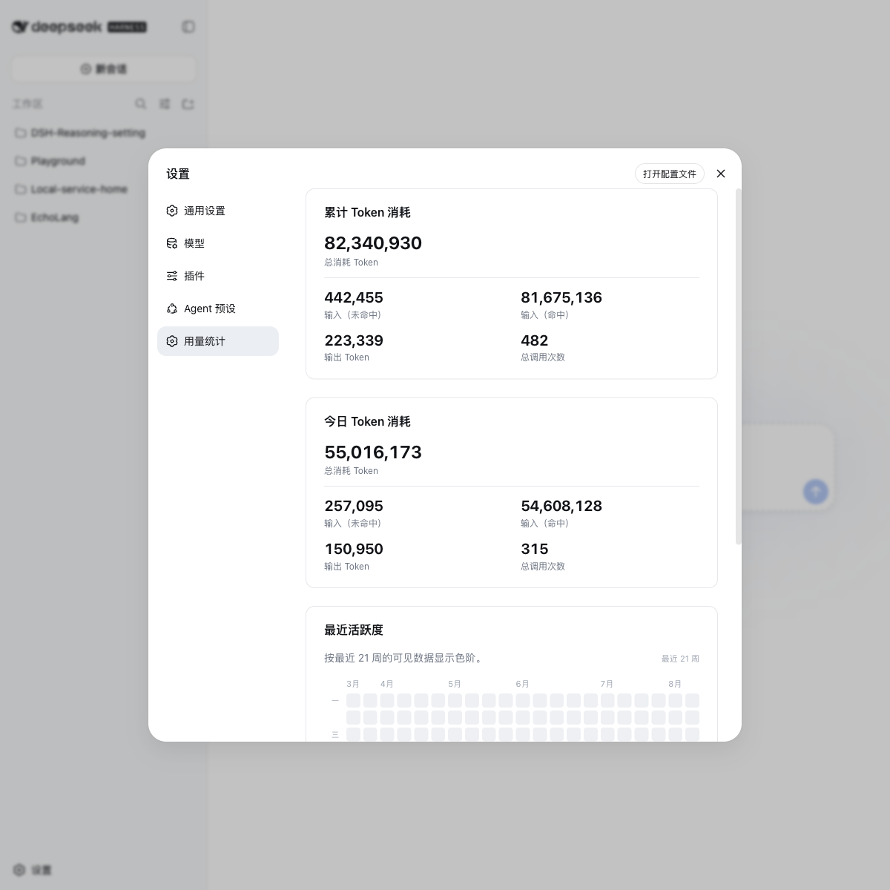
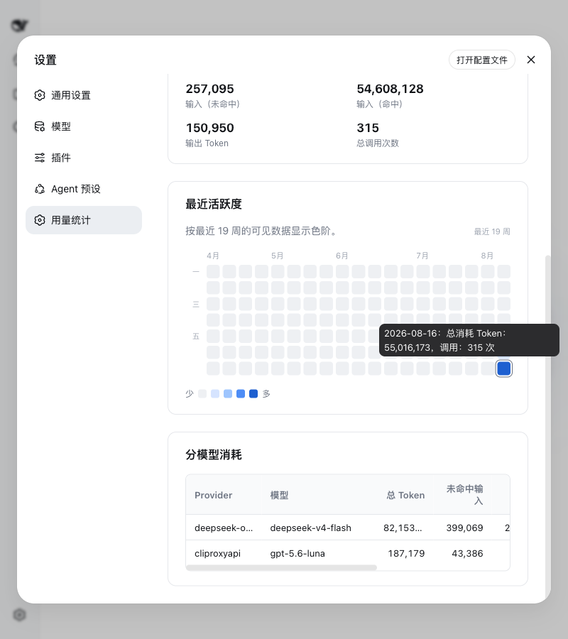

# Token 用量统计插件

[English](README.md) | 中文

<div align="center">
  <h2>看清每一个 Token 到底去了哪里。</h2>
  <p>为 DeepSeek Harness 提供持久、准确的用量统计。</p>
  <p>TypeScript · Cordis 插件 · 本地优先的 LLM 用量分析</p>
</div>

<p align="center">
  
</p>

`token-usage-counter` 是一个用于 DeepSeek Harness 的 Token 用量统计插件。
它会持久化 provider 上报的用量，支持全局、按会话、按 Provider / 模型查看，
并避免把失败请求或重试请求重复算入总量。

## 它解决了什么问题

| 能力 | 说明 |
| --- | --- |
| **精确分桶** | 输入（未命中）、输入（命中）、缓存写入、输出保持独立。 |
| **持久化累计** | 数据写入 Harness 的 `usage-stats` settings 命名空间，重启不会归零。 |
| **多维查看** | 支持全局、单个会话、Provider / 模型三个维度。 |
| **每日活跃度** | 为 Web 设置页的累计统计和本地日历热力图提供数据。 |
| **安全提交** | 只有匹配的成功消息确认后，usage-only chunk 才会计入。 |
| **交互式命令** | 挂载 `commands` 服务时提供 `/tokens`，随时查看当前摘要。 |

## 统计仪表盘

配套的 Web 设置视图强调“先看懂，再核对”：

- 三行累计卡片：总 Token、输入（未命中）、输入（命中）、输出 Token、总调用次数；
- 独立的**今日数据**卡片；
- 根据容器宽度动态适配的 12–52 周热力图；
- 鼠标悬停或键盘聚焦查看当日精确总 Token 和调用次数；
- 快照包含模型明细时，显示 Provider / 模型维度的统计。

<p align="center">
  
</p>

## 安装

把本目录复制到 Harness 项目可访问的位置，然后应用随附的 overlay：

```sh
dsh web --patch token-usage-counter/cordis.yml
```

或者在自己的 `cordis.yml` 中加入：

```yaml
- name: './token-usage-counter/token-usage-counter.ts'
```

插件依赖 `sessions` 和 `settings` 服务；当 `commands` 服务存在时，才会启用
`/tokens` 命令。

> 随附的 overlay 会先禁用内置的 `usage-stats` 行，再挂载本插件，因为两者使用
> 同一个 settings 命名空间。手动挂载时，请不要同时启用
> `@deepseek-ai/dsh-usage-stats`。

## API

插件提供 `ctx.tokenUsageCounter`：

```ts
ctx.tokenUsageCounter.getSummary()
ctx.tokenUsageCounter.getSession(sessionId)
ctx.tokenUsageCounter.getModel(provider, model)
ctx.tokenUsageCounter.formatSummary()
```

摘要包含全局、Provider / 模型、会话三个层级的统计。每个计数器都保留四个互不
重叠的 provider 用量分桶，以及 `totalTokens` 和 `calls`。

## 计数规则

插件监听持久化的 `session/event` 事件流，并在加载时接管已经存在的会话。只有
成功完成的锚点才会提交用量：

- `assistant/message.usage` 只计入一次；
- `compaction/summary.usage` 也会作为一次 provider 调用计入；
- 单独的 `assistant/chunk` 会等待匹配的 `assistant/message` 到达；
- 同一个 `(turn, step)` 同时出现 chunk 和最终消息时，以最终值替换早期样本；
- 失败请求、重试请求和 fork 会话的种子历史不会重复计入。

这样得到的是“已完成的 provider 工作量”，而不是原始流事件数量。

## 搜索关键词

DeepSeek Harness 插件 · Token 用量统计 · LLM Token 分析 · AI 用量统计 · Prompt
Cache 追踪 · 模型用量仪表盘 · 每日 Token 热力图 · TypeScript Cordis 插件 ·
本地优先可观测性 · Provider Token 计费

## 许可证

MIT
